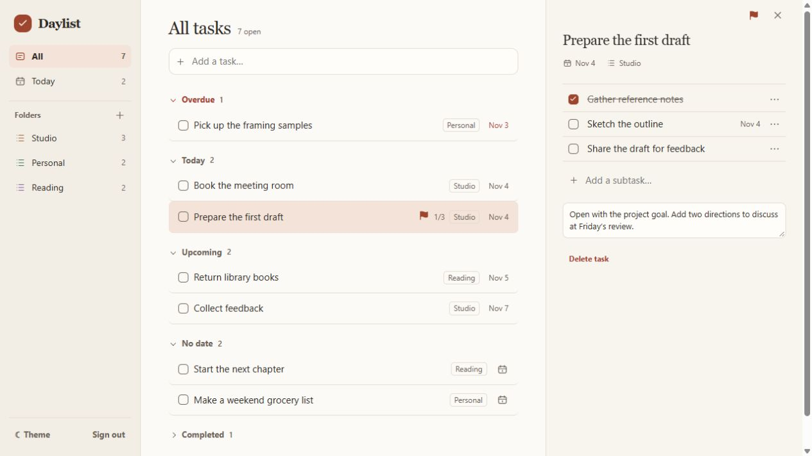
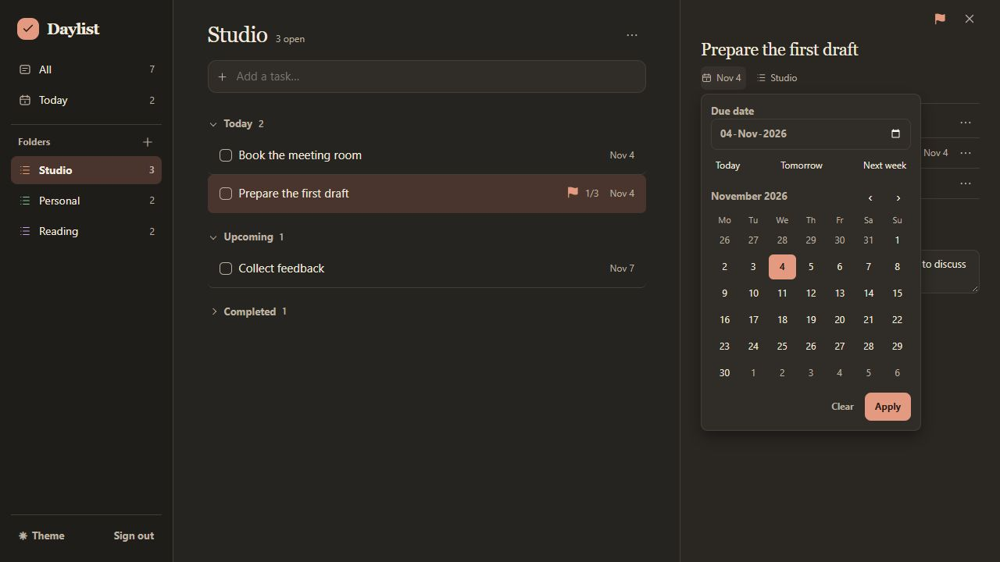

# Daylist

A single-user task workspace with All, Today, and custom folders. Select a task to see its details and manage subtasks and notes. Click the title, date, or folder in the details pane to edit it. Press Enter or tap the plus icon to add a task or subtask. Subtasks have independent checkboxes and optional due dates. Deleting a folder leaves its tasks in All, without a folder.

Click a task date or calendar icon to move it to Today, Tomorrow, Next week (seven days from today), or No date. In the quick-add field, finish a title with today, tomorrow, or next week to see a date suggestion. Dismiss the suggestion to keep the words in the title. Use the flag in task details to mark a task as a priority.

Today shows tasks whose due date matches the configured time zone. The theme follows your system until you choose light or dark in the sidebar. That choice stays in the current browser.

<table>
  <tr>
    <td width="50%" valign="top"><a href="docs/screenshots/daylist-light.jpg"></a></td>
    <td width="50%" valign="top"><a href="docs/screenshots/daylist-dark.jpg"></a></td>
  </tr>
</table>

## Install with Docker

1. Download `compose.yaml` from the [latest release](https://github.com/charya-s/daylist/releases/latest) into a new directory.
2. Create a `.env` file next to it and set `DJANGO_SECRET_KEY` to a private random value of at least 50 characters. For a local trial, also add `LOCAL_HTTP=1`. The app listens on localhost by default. For public access, follow the HTTPS setup below.
3. From that directory, run:

   ```sh
   docker compose up -d
   ```

4. Once the sign-in page is available, create your account and sign in at http://localhost:8000 for a local trial:

   ```sh
   docker compose exec app python manage.py createsuperuser
   ```

On Linux or macOS, `openssl rand -hex 32` generates a suitable secret. In PowerShell, use:

```powershell
$bytes = New-Object byte[] 48
$rng = [System.Security.Cryptography.RandomNumberGenerator]::Create()
$rng.GetBytes($bytes)
$rng.Dispose()
[Convert]::ToBase64String($bytes)
```

Save the generated value as `DJANGO_SECRET_KEY=your-generated-value` in `.env` and keep it private. To reset your password, run `docker compose exec app python manage.py changepassword YOUR_USERNAME`.

### Upgrade

Replace your install's `compose.yaml` with the file from the new release, keeping the same directory and `.env`. Run `docker compose pull` and then `docker compose up -d`. The app applies database migrations at startup. Back up the data volume before upgrading.

### Build from source

Use the repository's `compose.yaml` with `docker compose up -d --build`. Copy `.env.example` to `.env` and fill in the secret first.

## Serve it on your domain

Set `LOCAL_HTTP=0`, `APP_HOSTS=tasks.example.com` (replace with your domain), and `APP_TIME_ZONE` to your IANA time zone if it differs from Asia/Singapore. Point DNS to your server. The included Compose file binds the app to the host's loopback address. On the same host, configure a reverse proxy that terminates HTTPS and overwrites the forwarded protocol header. For example, add this to your host's Caddyfile and reload Caddy:

```caddyfile
tasks.example.com {
    reverse_proxy 127.0.0.1:8000
}
```

Allow inbound ports 80 and 443 for Caddy. Keep port 8000 private. Run `docker compose up -d` after changes to `.env`. Once HTTPS is working, sign in from a second device and confirm the same tasks appear.

The app uses Django sessions, CSRF protection, Argon2id password hashing, and a shared limit of ten sign-in attempts per minute per app instance. Run a single app instance with the supplied worker configuration.

## Storage and backups

SQLite lives in the persistent `task_data` volume. For encryption at rest, put Docker's volume storage on an encrypted disk and store backups on encrypted storage. A Docker volume alone does not encrypt its contents.

For a consistent backup on a Linux host, run these commands from the project directory, writing the archive to your encrypted storage. The app is briefly offline.

```sh
docker compose stop app
docker compose run --rm --no-deps -T app tar -C /data -cf - . > /path/on/encrypted-storage/daylist.tar
docker compose start app
```

Keep `.env` separately in secure storage. To test restoration, use a fresh Compose project with a different project name and no running Daylist instance on port 8000. From that project, restore the archive to the fresh volume before starting the app:

```sh
docker compose run --rm --no-deps -T app tar -C /data -xf - < /path/on/encrypted-storage/daylist.tar
docker compose up -d
```

Sign in and confirm that your tasks and dates match the backup.

